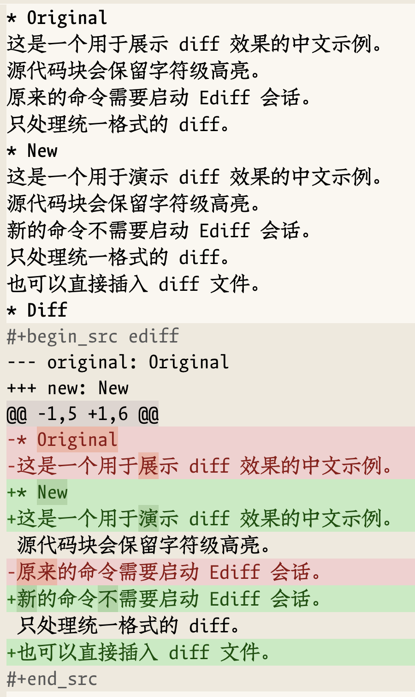

#+title: org-diff-src
#+subtitle: 在 Org 源码块中显示字符级高亮差异
#+author: TomoeMami
#+options: toc:2 num:nil

=org-diff-src= 将 unified diff（统一差异格式）显示为 Org 源码块，并把高亮
细化到实际发生变化的字符。它适合把可审阅的差异保存在笔记、issue 或 Org
文档中，而不必启动 Ediff 会话。

英文版见 [[file:README.org][README.org]]。

生成的源码块使用 =org-diff-src= 语言，高亮使用 =diff-mode= 的细化 face：
=diff-refine-removed= 、 =diff-refine-added= 和 =diff-refine-changed= 。

* 功能

- 可以渲染任意 unified diff 字符串。
- 在 Org 缓冲区中提供字符级高亮，而不只是整行的新增/删除 face。
- 默认使用内置的 =org-diff-src= 语言，无需额外配置；也可以通过
  =org-diff-src-setup= 注册 =ediff= 等别名。
- 比较两个 Org 子树、两个文件或两个缓冲区。
- 复制子树时不会修改 kill ring（剪贴环）或系统剪贴板。
- 不启动 Ediff 会话，除 Org 和 =diff-mode= 外不依赖其他包。
- 使用标准的补全界面，不要求安装 Consult。

* 环境要求

- Emacs 27.1 或更高版本。Emacs 27.1 自带的 Org（9.3）或更高版本即可。
- 一个 =diff= 可执行文件。推荐 GNU diffutils。程序会优先使用
  =--label= 传递标签；如果不可用，则回退到可移植的 =-L= 选项。

* 安装

** straight.el

#+begin_src elisp
(straight-use-package
 '(org-diff-src :type git :host github :repo "TomoeMami/org-diff-src"))
#+end_src

配合 =use-package= ：

#+begin_src elisp
(use-package org-diff-src
  :straight (:type git :host github :repo "TomoeMami/org-diff-src")
  :commands (org-diff-src-setup
             org-diff-src-compare-headings
             org-diff-src-compare-files
             org-diff-src-compare-buffers
             org-diff-src-insert-diff-file
             org-diff-src-insert-from-kill
             org-diff-src-wrap-region
             org-diff-src-refontify-block))
#+end_src

** 手动安装

克隆仓库并将目录加入 =load-path=：

#+begin_src elisp
(add-to-list 'load-path "/path/to/org-diff-src")
(require 'org-diff-src)
#+end_src

* 使用

** 比较两个 Org 子树

打开一个 Org 缓冲区，执行：

=M-x org-diff-src-compare-headings=

先选择原始标题，再选择新标题。两个子树会在不修改 kill ring 和系统剪贴板
的情况下被复制，统一提升到一级标题，用 =diff= 比较，然后以
=org-diff-src= 源码块的形式插入到光标处。

例如，对于下面的内容：

#+begin_src org
* Original
Some text.
foo bar baz

* New
Some text.
foo BAR baz
#+end_src

依次选择 =Original= 和 =New= 后，会得到：

#+begin_example
#+begin_src org-diff-src
--- original: Original
+++ new: New
@@ -1,3 +1,3 @@
-* Original
+* New
 Some text.
-foo bar baz
+foo BAR baz
#+end_src
#+end_example

发生变化的字符（ =Original= / =New= 以及 =bar= / =BAR= ）会使用字符级 face
高亮。标题行也属于比较范围，因此标题本身的变化也会出现在差异中。

#+caption: 渲染后的 diff 块，包含字符级高亮。截图中的块使用 =ediff= 别名。

** 语言名与别名

默认源码语言是 =org-diff-src= 。Org 会自动把它解析为
=org-diff-src-mode= ，因此新生成的源码块不需要额外配置。

如果你已经有写成 =ediff= 的源码块（例如来自最初的 snippet），注册一次别名
即可：

#+begin_src elisp
(require 'org-diff-src)
(org-diff-src-setup)
#+end_src

=org-diff-src-setup= 会把 =org-diff-src-extra-languages= （默认
=("ediff")= ）中的每个语言映射到 =org-diff-src-mode= 。请在 Org 字体化
这些源码块之前执行。

如果希望新插入的源码块也使用 =ediff= ：

#+begin_src elisp
(setq org-diff-src-default-language "ediff")
#+end_src

也可以显式注册更多别名。把 =diff= 映射进来会让所有 Org =diff= 源码块都
使用本模式，因此只在你确实希望如此时才这样做：

#+begin_src elisp
(org-diff-src-setup '("ediff" "diff"))
#+end_src

** 渲染已有的 diff

- 复制一段 diff（例如从 Magit 中复制），然后执行
  =M-x org-diff-src-insert-from-kill= 。
- 选中 diff 文本，执行 =M-x org-diff-src-wrap-region= ，用带高亮的源码块
  替换该区域。
- 执行 =M-x org-diff-src-insert-diff-file= ，把 diff 文件的内容插入为
  源码块。

** 比较文件或缓冲区

- =M-x org-diff-src-compare-files= 会依次询问原始文件和新文件。
- =M-x org-diff-src-compare-buffers= 会依次询问原始缓冲区和新缓冲区。

两个命令都会把结果插入到当前 Org 缓冲区的光标处。

** 重新字体化源码块

Org 通常会在编辑后重新字体化源码块。如果 Lisp 代码修改了源码块却没有触发
字体化，可以执行：

=M-x org-diff-src-refontify-block=

* 命令

| 命令                            | 用途                               |
|---------------------------------+------------------------------------|
| =org-diff-src-setup=            | 注册 =ediff= 等语言别名。          |
| =org-diff-src-compare-headings= | 比较当前 Org 缓冲区中的两个子树。  |
| =org-diff-src-compare-files=    | 比较两个文件。                     |
| =org-diff-src-compare-buffers=  | 比较两个缓冲区。                   |
| =org-diff-src-insert-diff-file= | 把 diff 文件插入为源码块。         |
| =org-diff-src-insert-from-kill= | 把当前 kill 插入为源码块。         |
| =org-diff-src-wrap-region=      | 用源码块替换当前区域。             |
| =org-diff-src-refontify-block=  | 重新字体化光标处的源码块。         |

* Lisp API

生成 diff 和插入源码块的函数与交互命令相互独立，因此可以被其他包复用。

- =(org-diff-src-insert DIFF &optional LANGUAGE)= :: 在光标处把 =DIFF=
  插入为带高亮的源码块，并返回源码块之后的位置。 =LANGUAGE= 默认为
  =org-diff-src-default-language= ，并且必须映射到
  =org-diff-src-mode= ；内置的 =org-diff-src= 语言会自动映射。如果
  =DIFF= 为 nil 或空字符串，则插入 =org-diff-src-no-diff-message= 。
- =(org-diff-src-setup &optional LANGUAGES)= :: 把 =LANGUAGES= （默认
  =org-diff-src-extra-languages= ）注册到 =org-diff-src-mode= ，并返回
  注册的语言列表。
- =(org-diff-src-diff-strings OLD NEW &optional OLD-LABEL NEW-LABEL CODING)= ::
  返回字符串 =OLD= 和 =NEW= 之间的 unified diff。
- =(org-diff-src-diff-files OLD-FILE NEW-FILE &optional OLD-LABEL NEW-LABEL)= ::
  返回两个文件之间的 unified diff。远程文件会先复制到本地临时文件。
- =(org-diff-src-diff-buffers OLD-BUFFER NEW-BUFFER &optional OLD-LABEL
  NEW-LABEL)= :: 返回两个缓冲区完整内容之间的 unified diff。
- =org-diff-src-mode= :: 源码块使用的主模式。它派生自 =diff-mode= ，把
  =diff-refine= 设为 =font-lock= ，并把细化结果写成文本属性。

示例：

#+begin_src elisp
(with-current-buffer (get-buffer-create "*diff-demo*")
  (org-mode)
  (org-diff-src-insert
   (org-diff-src-diff-strings
    "The quick brown fox\n"
    "The quick red fox\n"
    "before" "after")))
#+end_src

以编程方式比较两个缓冲区：

#+begin_src elisp
(org-diff-src-insert
 (org-diff-src-diff-buffers (get-buffer "notes-a")
                            (get-buffer "notes-b")
                            "before" "after"))
#+end_src

默认源码语言是 =org-diff-src= 。Org 会通过 =org-src-get-lang-mode=
将其解析为 =org-diff-src-mode= ，不需要修改 =org-src-lang-modes= 。通过
=org-diff-src-setup= 注册的别名也会以同样的方式解析。

* 实现原理

Org 在字体化源码块时，会从临时缓冲区复制 font-lock 的 =face= 文本属性，
但不会复制 overlay。而 =diff-mode= 的字符级细化高亮是用 overlay 实现的，
所以直接把 diff 放进 Org 时，细化高亮通常会丢失。

=org-diff-src-mode= 的处理方式是：

1. 从 =diff-mode= 派生。
2. 把 =diff-refine= 设为 =font-lock= ，让 font-lock 计算细化结果。
3. 用自定义函数替换 =diff--font-lock-refined= ，把细化 overlay 的 face
   复制为 =face= 文本属性。
4. Org 的 =org-src-font-lock-fontify-block= 随后就能把这些属性复制到 Org
   缓冲区中。

如果未来的 Emacs 移除了 diff-mode 的细化内部接口， =org-diff-src-mode= 会
保留普通的行级高亮，而不是直接报错。

这也是默认源码语言使用 =org-diff-src= 而不是 =diff= 的原因： =diff= 会映射
到普通的 =diff-mode= ，除非你显式把它注册为别名。

* 自定义

- =org-diff-src-diff-switches= :: 传递给 =diff-command= 的参数，默认是
  =("-u")=。如果添加其他参数，请保留 =-u= ，因为细化代码需要 unified
  diff。
- =org-diff-src-no-diff-message= :: 差异为空时插入的文本，默认是
  =# No differences= 。
- =org-diff-src-default-language= :: 插入源码块时使用的语言，默认是
  ="org-diff-src"= 。
- =org-diff-src-extra-languages= :: 由 =org-diff-src-setup= 注册的语言，
  默认是 =("ediff")= 。
- =org-diff-src-fontify-immediately= :: 是否在插入源码块后立即字体化，
  默认是 =t= 。对于很大的 diff，可以设为 nil。
- Face :: 细化高亮使用 =diff-refine-removed= 、=diff-refine-added= 和
  =diff-refine-changed= 。可以通过 =M-x customize-face= 或在
  =custom-set-faces= 中自定义。

该模式只在缓冲区局部设置 =diff-refine=，不需要修改它的全局值。

* 限制

- 只会细化 unified diff。Context diff 和 normal diff 会作为普通文本显示。
- 字符级颜色是 Emacs 的显示属性。把 Org 文件导出为 HTML 或 PDF 时，diff
  文本仍会保留，但不一定保留细化颜色。
- 很大的 diff 在字体化时可能较慢，因为细化是逐字符计算的。
- 差异两侧的标签会被压缩成一行。
- 如果未来的 Emacs 移除了 diff-mode 的细化内部接口，本包会退化为行级高亮。
- =org-diff-src-compare-headings= 比较的是完整子树，包括标题行。如果只想
  比较部分正文，可以使用 =org-diff-src-diff-strings= 。
- 本包用于渲染静态 diff，不能替代 Ediff 或 Magit 的交互式合并功能。

* 开发

#+begin_src shell
make compile       # 字节编译
make test          # 运行 ERT 测试
make checkdoc      # 运行 checkdoc
make package-lint  # 需要预先安装 package-lint
make clean
#+end_src

测试文件位于 [[file:test/org-diff-src-test.el][test/org-diff-src-test.el]]。

** 扩展新的 diff 来源

producer 就是一个返回 unified diff 字符串的函数。例如：

#+begin_src elisp
(defun my/org-diff-src-from-git (rev-a rev-b)
  "返回 REV-A 和 REV-B 之间的 unified diff。"
  (with-temp-buffer
    (let ((status (call-process "git" nil t nil
                                "diff" "-u" (concat rev-a ".." rev-b))))
      (unless (memq status '(0 1))
        (error "git diff failed: %s" (buffer-string))))
    (buffer-string)))

(org-diff-src-insert (my/org-diff-src-from-git "HEAD~1" "HEAD"))
#+end_src

渲染层只关心 unified diff 文本，因此新的 producer 不需要修改
=org-diff-src-mode= 。

* 许可证

GPL-3.0-or-later。参见 [[file:LICENSE][LICENSE]]。

本包最初来自一段个人 Org 配置代码，用于插入类似 Ediff 的 diff；现在把其中
的 diff 渲染和插入逻辑抽象成了通用包。
