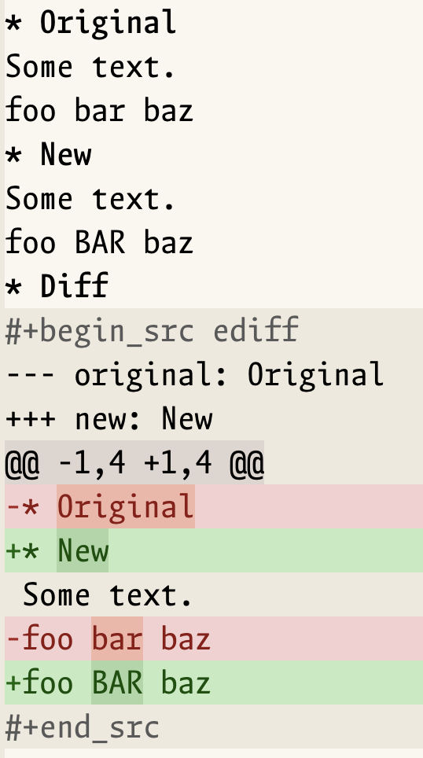

#+title: org-diff-src
#+subtitle: Character-level highlighted diffs in Org source blocks
#+author: TomoeMami
#+options: toc:2 num:nil

=org-diff-src= displays a unified diff as an Org source block and refines the
display down to the characters that actually changed.  It is meant for keeping
a reviewable diff inside notes, an issue, or an Org document without starting
an Ediff session.

A Chinese translation is available at [[file:README-cn.org][README-cn.org]].

The generated block uses the source language =org-diff-src= and the
refinement faces from =diff-mode=: =diff-refine-removed=,
=diff-refine-added=, and =diff-refine-changed=.

* Features

- Render any unified diff string, not only diffs of Org subtrees.
- Character-level highlighting inside the Org buffer, not just line-level
  added/removed faces.
- Use the built-in =org-diff-src= language without setup, or register
  =ediff=-style aliases with =org-diff-src-setup=.
- Compare two Org subtrees, two files, or two buffers.
- Copy subtrees without changing the kill ring or the system clipboard.
- Start no Ediff session and require no package beyond Org and =diff-mode=.
- Use standard completion; Consult is not required.

* Requirements

- Emacs 27.1 or later.  The Org version bundled with Emacs 27.1 (Org 9.3) or
  newer is sufficient.
- A =diff= executable.  GNU diffutils is recommended.  Labels are passed with
  =--label= when available and fall back to the portable =-L= option.
* Installation

** straight.el

#+begin_src elisp
(straight-use-package
 '(org-diff-src :type git :host github :repo "TomoeMami/org-diff-src"))
#+end_src

With =use-package=:

#+begin_src elisp
(use-package org-diff-src
  :straight (:type git :host github :repo "TomoeMami/org-diff-src")
  :commands (org-diff-src-setup
             org-diff-src-compare-headings
             org-diff-src-compare-files
             org-diff-src-compare-buffers
             org-diff-src-insert-diff-file
             org-diff-src-insert-from-kill
             org-diff-src-wrap-region
             org-diff-src-refontify-block))
#+end_src

** Manual

Clone the repository and add it to =load-path=:

#+begin_src elisp
(add-to-list 'load-path "/path/to/org-diff-src")
(require 'org-diff-src)
#+end_src

* Usage

** Compare two Org subtrees

Open an Org buffer and run:

=M-x org-diff-src-compare-headings=

Select the original heading, then the new heading.  Both subtrees are copied
without touching the kill ring or clipboard, normalized to level 1, compared
with =diff=, and inserted at point as an =org-diff-src= source block.

For example, given:

#+begin_src org
* Original
Some text.
foo bar baz

* New
Some text.
foo BAR baz
#+end_src

selecting =Original= and then =New= produces:

#+begin_example
#+begin_src org-diff-src
--- original: Original
+++ new: New
@@ -1,3 +1,3 @@
-* Original
+* New
 Some text.
-foo bar baz
+foo BAR baz
#+end_src
#+end_example

The changed characters (=Original= / =New= and =bar= / =BAR=) are refined with
character-level faces.  The heading lines are part of the comparison, so a
changed title appears in the diff as well.

#+caption: A rendered diff block with character-level refinement.  The
#+caption: screenshot uses the =ediff= alias.

** Language names and aliases

The default source language is =org-diff-src=.  Org resolves it to
=org-diff-src-mode= automatically, so newly generated blocks need no setup.

If you already have blocks written as =ediff= (for example from the original
snippet), register the alias once:

#+begin_src elisp
(require 'org-diff-src)
(org-diff-src-setup)
#+end_src

=org-diff-src-setup= maps every language in
=org-diff-src-extra-languages= (default =("ediff")=) to
=org-diff-src-mode=.  Run it before Org fontifies those blocks.

To make newly inserted blocks use =ediff= as well:

#+begin_src elisp
(setq org-diff-src-default-language "ediff")
#+end_src

You can register more aliases explicitly.  Mapping =diff= makes every Org
=diff= block use this mode, so do it only if that is what you want:

#+begin_src elisp
(org-diff-src-setup '("ediff" "diff"))
#+end_src

** Render a diff you already have

- Copy a diff (for example from Magit) and run
  =M-x org-diff-src-insert-from-kill=.
- Select the diff text and run =M-x org-diff-src-wrap-region= to replace the
  region with a fontified block.
- Run =M-x org-diff-src-insert-diff-file= to insert the contents of a diff
  file.

** Compare files or buffers

- =M-x org-diff-src-compare-files= prompts for an original file and a new
  file.
- =M-x org-diff-src-compare-buffers= prompts for an original buffer and a new
  buffer.

Both commands insert the result at point in the current Org buffer.

** Refontify a block

Org normally refontifies source blocks after edits.  If Lisp code changes a
block without triggering fontification, run:

=M-x org-diff-src-refontify-block=

* Commands

| Command                            | Purpose                                             |
|------------------------------------+-----------------------------------------------------|
| =org-diff-src-setup=               | Register language aliases such as =ediff=.          |
| =org-diff-src-compare-headings=    | Compare two subtrees in the current Org buffer.     |
| =org-diff-src-compare-files=       | Compare two files.                                  |
| =org-diff-src-compare-buffers=     | Compare two buffers.                                |
| =org-diff-src-insert-diff-file=    | Insert a diff file as a source block.               |
| =org-diff-src-insert-from-kill=    | Insert the current kill as a source block.          |
| =org-diff-src-wrap-region=         | Replace the region with a source block.             |
| =org-diff-src-refontify-block=     | Refontify the block at point.                       |

* Lisp API

The diff-generation and insertion functions are independent of the interactive
commands, so they can be used from other packages.

- =(org-diff-src-insert DIFF &optional LANGUAGE)= :: Insert =DIFF= as a
  fontified source block at point.  =LANGUAGE= defaults to
  =org-diff-src-default-language= and must map to =org-diff-src-mode=; the
  built-in =org-diff-src= language does so automatically.  Return the position
  after the block.  If =DIFF= is nil or empty, insert
  =org-diff-src-no-diff-message=.
- =(org-diff-src-setup &optional LANGUAGES)= :: Register =LANGUAGES= (default
  =org-diff-src-extra-languages=) for =org-diff-src-mode=.  Return the list of
  registered languages.
- =(org-diff-src-diff-strings OLD NEW &optional OLD-LABEL NEW-LABEL CODING)= ::
  Return a unified diff between the strings =OLD= and =NEW=.
- =(org-diff-src-diff-files OLD-FILE NEW-FILE &optional OLD-LABEL NEW-LABEL)= ::
  Return a unified diff between two files.  Remote files are copied locally
  first.
- =(org-diff-src-diff-buffers OLD-BUFFER NEW-BUFFER &optional OLD-LABEL
  NEW-LABEL)= :: Return a unified diff between the entire contents of two
  buffers.
- =org-diff-src-mode= :: The major mode used for the block.  It derives from
  =diff-mode=, sets =diff-refine= to =font-lock=, and writes refinement as
  text properties.

Example:

#+begin_src elisp
(with-current-buffer (get-buffer-create "*diff-demo*")
  (org-mode)
  (org-diff-src-insert
   (org-diff-src-diff-strings
    "The quick brown fox\n"
    "The quick red fox\n"
    "before" "after")))
#+end_src

To compare two buffers programmatically:

#+begin_src elisp
(org-diff-src-insert
 (org-diff-src-diff-buffers (get-buffer "notes-a")
                            (get-buffer "notes-b")
                            "before" "after"))
#+end_src

The default source language is =org-diff-src=; Org resolves it to
=org-diff-src-mode= through =org-src-get-lang-mode=, so no entry in
=org-src-lang-modes= is needed.  Aliases registered with
=org-diff-src-setup= are resolved the same way.

* How it works

Org copies font-lock =face= text properties, but not overlays, from the
temporary buffer that it uses to fontify a source block.  =diff-mode=
implements its fine-grained refinement with overlays, so the refinement is
normally lost when a diff is displayed inside Org.

=org-diff-src-mode= works around this:

1. It derives from =diff-mode=.
2. It sets =diff-refine= to =font-lock= so that refinement is computed by
   font-lock.
3. It replaces =diff--font-lock-refined= with a function that copies the
   refinement overlay faces into =face= text properties.
4. Org's =org-src-font-lock-fontify-block= can then copy those properties into
   the Org buffer.

If a future Emacs version removes the diff-mode refinement internals,
=org-diff-src-mode= keeps the normal line-level highlighting instead of
failing.

This is why the default block language is =org-diff-src= rather than =diff=.
The latter maps to plain =diff-mode= unless you explicitly register it as an
alias.

* Customization

- =org-diff-src-diff-switches= :: Switches passed to =diff-command=.  The
  default is =("-u")=.  If you add switches, keep =-u= in the list because the
  refinement code expects a unified diff.
- =org-diff-src-no-diff-message= :: Text inserted when the diff is empty.  The
  default is =# No differences=.
- =org-diff-src-default-language= :: Language used for inserted blocks.  The
  default is ="org-diff-src"=.
- =org-diff-src-extra-languages= :: Languages registered by
  =org-diff-src-setup=.  The default is =("ediff")=.
- =org-diff-src-fontify-immediately= :: Whether to fontify newly inserted
  blocks immediately.  The default is =t=; turn it off for very large diffs.
- Faces :: The refinement uses =diff-refine-removed=,
  =diff-refine-added=, and =diff-refine-changed=.  Customize them with
  =M-x customize-face= or in =custom-set-faces=.

The mode sets =diff-refine= buffer-locally.  You do not need to change the
global value of =diff-refine=.

* Limitations

- Only unified diffs are refined.  Context diffs and normal diffs are displayed
  as plain text.
- The character-level colors are Emacs display properties.  HTML or PDF export
  of the Org file shows the diff text, but not necessarily the refinement
  colors.
- Very large diffs can be slow to fontify because refinement is done per
  changed character.
- Labels for the two diff sides are reduced to one line.
- If a future Emacs removes the diff-mode refinement internals, the package
  falls back to line-level highlighting.
- =org-diff-src-compare-headings= compares whole subtrees, including the
  heading lines.  Use =org-diff-src-diff-strings= if you want to compare only
  selected body text.
- This package renders static diffs.  It is not a replacement for Ediff or
  Magit when you need interactive merging.

* Development

#+begin_src shell
make compile       # byte-compile the package
make test          # run the ERT test suite
make checkdoc      # run checkdoc
make package-lint  # requires package-lint to be installed
make clean
#+end_src

The test suite is in [[file:test/org-diff-src-test.el][test/org-diff-src-test.el]].

** Adding another diff source

A producer is simply a function that returns a unified diff string.  For
example:

#+begin_src elisp
(defun my/org-diff-src-from-git (rev-a rev-b)
  "Return a unified diff between REV-A and REV-B."
  (with-temp-buffer
    (let ((status (call-process "git" nil t nil
                                "diff" "-u" (concat rev-a ".." rev-b))))
      (unless (memq status '(0 1))
        (error "git diff failed: %s" (buffer-string))))
    (buffer-string)))

(org-diff-src-insert (my/org-diff-src-from-git "HEAD~1" "HEAD"))
#+end_src

The rendering layer only cares about the unified diff text, so new producers
do not need to touch =org-diff-src-mode=.

* License

GPL-3.0-or-later.  See [[file:LICENSE][LICENSE]].

The original implementation was a personal Org configuration snippet for
inserting Ediff-like diffs; this package generalizes its diff rendering and
insertion layer.
